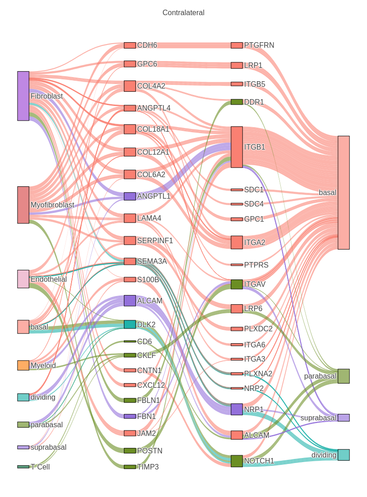
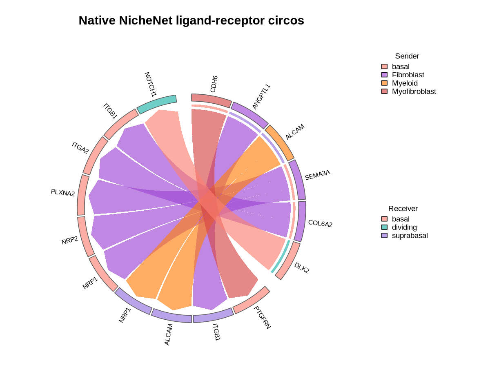

<!-- Generated from the companion Jupyter notebook. Open this file in RStudio and run chunks interactively. -->

# ContextNet Workflow: Ligand Activity for Contralateral Receiver Cell States

## Biological System

This tutorial uses the head-and-neck squamous cell carcinoma (HNSCC) contralateral sc-multiome dataset and restricts the analysis to **contralateral tissue** (`C`). Contralateral tissue provides one tissue context for asking which ligand activities explain receiver cell states. Paper link: [HNSCC manuscript](../README.md#citation).

In this dataset, the receiver cell states are four epithelial subtypes: **basal**, **parabasal**, **suprabasal**, and **dividing** cells. ContextNet asks which sender-cell ligands can explain the gene program that distinguishes each receiver cell state from the other cell states in the same tissue.

## Biological Question

Question addressed: **within contralateral HNSCC tissue, which sender ligands have the strongest ContextNet support for each receiver cell-state program?**

The goal is to identify ligand activities and target genes that explain receiver cell-state programs inside the contralateral tissue context. Each analysis defines one receiver cell state against the other receiver states, then asks which ligands recover that state program through the ContextNet ligand-target matrix.

## Workflow Outline

This tutorial:

- Builds a reusable `ContextNetwork` from a context-specific gene regulatory network (GRN).
- Runs a ContextNet ligand-activity analysis in one biological tissue context.
- Runs ligand prioritization for basal, parabasal, suprabasal, and dividing receiver cell states.
- Interprets ligand activity scores, ligand-target support, and ccflowR Sankey river plots. ccflowR is optional visualization support for path-level communication hypotheses: it turns sender -> ligand -> receptor -> receiver tables into river diagrams that are easier to inspect than long ranked tables.
- Exports receiver-cell result tables for downstream review.

## Environment and Data Setup

Install ContextNet before starting this tutorial using the repository [installation instructions](../README.md#installation). The cells below are not installation steps. They only load packages, set public relative data paths, and define the biological analysis used in this notebook.

```{r 02_standard_workflow_cell_02, message=TRUE, warning=TRUE}
suppressWarnings(suppressPackageStartupMessages({
    library(ContextNet)
    library(Seurat)
    library(nichenetr)
    library(dplyr)
    library(ggplot2)
    library(ccflowR)
}))

theme_set(theme_minimal(base_family = "sans"))


display_ccflowr_sankey <- function(sankey_plot, width, height, preview = TRUE, preview_file = NULL) {
    # Display the actual interactive ccflowR widget in Jupyter/JupyterLab.
    fig <- ccflowR::sankey_render(sankey_plot)
    if (requireNamespace("repr", quietly = TRUE) && requireNamespace("IRdisplay", quietly = TRUE)) {
        fig$width <- width
        fig$height <- height
        IRdisplay::display_html(repr::repr_html(fig))
    } else {
        print(sankey_plot)
    }

    if (!preview) {
        return(invisible(sankey_plot))
    }
    if (!requireNamespace("IRdisplay", quietly = TRUE)) {
        message("Skipping ccflowR PNG preview because IRdisplay is unavailable.")
        return(invisible(sankey_plot))
    }

    if (is.null(preview_file)) {
        png_file <- tempfile(fileext = ".png")
    } else {
        png_file <- preview_file
        dir.create(dirname(png_file), recursive = TRUE, showWarnings = FALSE)
    }
    exported <- FALSE
    tryCatch({
        suppressMessages(ccflowR::sankey_save(sankey_plot, png_file, width = width, height = height))
        exported <- file.exists(png_file) && file.info(png_file)[["size"]] > 0
    }, error = function(e) {
        message(
            "Skipping ccflowR PNG preview because static export requires Kaleido or webshot2: ",
            conditionMessage(e)
        )
    })

    if (exported) {
        # Embed the PNG generated by ccflowR::sankey_save() so notebook
        # viewers that block JavaScript still show the ccflowR river plot.
        IRdisplay::display_png(file = png_file)
    } else {
        warning("ccflowR PNG preview was not created. The interactive ccflowR widget above is still available.")
    }

    invisible(sankey_plot)
}
```

```{r 02_standard_workflow_cell_03, message=TRUE, warning=TRUE}
# USER CONFIGURATION
# The HNSCC tutorial data should be placed under data/ after download from
# the ContextNet tutorial data release. Environment variables can override
# these defaults without changing the notebook source.

PROJECT_DIR <- normalizePath(getwd(), mustWork = TRUE)
if (basename(PROJECT_DIR) == "notebooks" &&
    file.exists(file.path(PROJECT_DIR, "..", "DESCRIPTION"))) {
    PROJECT_DIR <- normalizePath(file.path(PROJECT_DIR, ".."), mustWork = TRUE)
}
if (!file.exists(file.path(PROJECT_DIR, "DESCRIPTION"))) {
    stop("Run this notebook from the ContextNet repository root or from the notebooks/ directory.")
}
setwd(PROJECT_DIR)

display_path <- function(path) {
    normalized <- normalizePath(path, mustWork = FALSE)
    root <- normalizePath(PROJECT_DIR, mustWork = TRUE)
    if (startsWith(normalized, root)) {
        return(sub("^/", "", substring(normalized, nchar(root) + 1)))
    }
    paste0("<external>/", basename(normalized))
}

cat("Using project root:", basename(getwd()), "\n")

DATA_PATH <- file.path(PROJECT_DIR, "data")
GRN_FILE <- Sys.getenv("CONTEXTNET_TUTORIAL02_GRN", unset = file.path(DATA_PATH, "gene_x_tf.csv"))
SEURAT_FILE <- Sys.getenv("CONTEXTNET_TUTORIAL_SEURAT", unset = file.path(DATA_PATH, "seurat_obj.rds"))
NICHENET_DB <- Sys.getenv("CONTEXTNET_NICHENET_DB", unset = DATA_PATH)

# Repo-local derived outputs. The cache name is specific to the contralateral
# GRN so Tutorial 03 cannot accidentally reuse a different ligand-target matrix.
CACHE_DIR <- file.path(DATA_PATH, "cache")
NETWORK_CACHE <- file.path(CACHE_DIR, "contextnet_network_contralateral.rds")
OUTPUT_DIR <- file.path(CACHE_DIR, "tutorial-02-outputs")
RECEIVER_RESULTS_CACHE <- file.path(OUTPUT_DIR, "contralateral_receiver_results.rds")
FIGURE3_RECEIVER_RESULTS_CACHE <- file.path(OUTPUT_DIR, "contralateral_figure3_receiver_results.rds")
USE_PRECOMPUTED_RECEIVER_RESULTS <- tolower(Sys.getenv(
    "CONTEXTNET_USE_PRECOMPUTED_TUTORIAL02",
    unset = "true"
)) %in% c("true", "1", "yes")

# Analysis parameters: contralateral-only epithelial-subtype comparison.
TISSUE_COL <- "category"
TISSUE_VALUE <- "C"
GROUP_COL <- "Fine_Cell_Types"
SENDER <- NULL        # NULL auto-detects sender cell types by abundance.
RECEIVERS <- c("basal", "parabasal", "suprabasal", "dividing")
MIN_CELLS <- 500      # Minimum cells required for automatic sender inclusion.
TOP_N_LIGANDS <- 30   # Ligands retained for ranking tables, target review, and Sankey input.

# Each epithelial subtype is compared with the other epithelial subtypes.
RECEIVER_COMPARISONS <- stats::setNames(
    lapply(RECEIVERS, function(receiver) setdiff(RECEIVERS, receiver)),
    RECEIVERS
)

missing_inputs <- c(GRN_FILE, SEURAT_FILE)[!file.exists(c(GRN_FILE, SEURAT_FILE))]
if (length(missing_inputs) > 0 || !dir.exists(NICHENET_DB)) {
    stop("Missing HNSCC tutorial data. Download the tutorial files into data/ or set CONTEXTNET_TUTORIAL02_GRN, CONTEXTNET_TUTORIAL_SEURAT, and CONTEXTNET_NICHENET_DB.")
}
stopifnot(requireNamespace("ccflowR", quietly = TRUE))
cat("GRN file:", display_path(GRN_FILE), "\n")
cat("Seurat file:", display_path(SEURAT_FILE), "\n")


cat("NicheNet DB:", display_path(NICHENET_DB), "\n")
```

## Step 1: Import GRN

The context-specific GRN is a gene × TF matrix (CSV) where rows are target genes, columns are transcription factors, and values are regulatory weights inferred from matched scRNA-seq + scATAC-seq data.

```{r 02_standard_workflow_cell_05, message=TRUE, warning=TRUE}
grn <- import_grn(GRN_FILE, format = "pipeline")
cat("Imported ContextGRN from:", display_path(GRN_FILE), "\n")
cat("  TFs:", length(tfs(grn)), "\n")
cat("  Target genes:", length(targets(grn)), "\n")
cat("  Regulatory edges:", length(grn), "\n")

if (length(targets(grn)) == 12742) {
    cat("HNSCC tutorial GRN dimensions match the expected contralateral analysis input.\n")
} else {
    warning("GRN dimensions differ from the HNSCC tutorial data; ligand rankings and figures may differ.")
}
```

```{r 02_standard_workflow_cell_06, message=TRUE, warning=TRUE}
# Preview the regulatory evidence that will be propagated through NicheNet.
head(edges(grn))
```

## Step 2: Integrate with NicheNet

This integrates the context-specific GRN with NicheNet's curated ligand-receptor interactions and signaling pathways. The result is a context-specific ligand-target matrix computed via Personalized PageRank.

Three integration modes are available:
- **`replace`** (default): Use the context-specific GRN as the regulatory layer
- **`augment`**: Add context-specific GRN edges to the prior regulatory layer
- **`weighted`**: Use a weighted combination of the prior regulatory layer and the context-specific GRN

> **Matrix reuse:** The ligand-target matrix produced here is a standard R matrix. It can be extracted with `ligand_target_matrix(network)` and used directly in a [nichenetr workflow](https://github.com/saeyslab/nichenetr/blob/master/vignettes/seurat_steps.md) wherever the workflow expects `ligand_target_matrix`. ContextNet's wrappers below use that matrix for receiver gene-set definition, ligand-activity scoring, target extraction, and ccflowR input, but the matrix itself can also be passed to native nichenetr plotting functions.

### What the `ContextNetwork` Represents

`integrate_networks()` returns a `ContextNetwork`. This is the central reusable object in ContextNet: it stores a context-specific ligand-target matrix generated by propagating NicheNet ligand-receptor/signaling information through the GRN. A column is a ligand, a row is a target gene, and each entry is the regulatory-potential score connecting that ligand to that target in this biological context.

Because this object is independent of one sender/receiver contrast, it can be saved once and reused across many downstream analyses.

```{r 02_standard_workflow_cell_09, message=TRUE, warning=TRUE}
# Use the cached ContextNetwork when available; rebuilding the ligand-target
# matrix is the slowest setup step in this tutorial.
if (file.exists(NETWORK_CACHE)) {
    network <- readRDS(NETWORK_CACHE)
    cat("Loaded cached ContextNetwork from:", display_path(NETWORK_CACHE), "\n")
} else {
    network <- integrate_networks(
        grn,
        nichenet_database = NICHENET_DB,
        mode = "replace"  # use the HNSCC GRN as the regulatory layer
    )
}
ltm <- ligand_target_matrix(network)
cat("ContextNetwork ready\n")
cat("  Ligands:", length(ligands(network)), "\n")
cat("  Target genes:", length(targets(network)), "\n")
cat("  Ligand-target matrix:", nrow(ltm), "targets x", ncol(ltm), "ligands\n")
```

```{r 02_standard_workflow_cell_10, message=TRUE, warning=TRUE}
# Cache the network for reuse so the integration step is not repeated.
if (!dir.exists(CACHE_DIR)) dir.create(CACHE_DIR, recursive = TRUE)
saveRDS(network, NETWORK_CACHE)
cat("Cached ContextNetwork to:", display_path(NETWORK_CACHE), "\n")
integration_params(network)
```

## Step 3: Load Contralateral Expression Data

This workflow uses **only contralateral tissue**. Within that single tissue context, each epithelial subtype is compared against the other epithelial subtypes.

```{r 02_standard_workflow_cell_12, message=TRUE, warning=TRUE}
seurat_obj <- readRDS(SEURAT_FILE)
seurat_c <- subset(seurat_obj, subset = category == TISSUE_VALUE)
seurat_c[[TISSUE_COL]] <- droplevels(as.factor(seurat_c[[TISSUE_COL]][, 1]))
seurat_c[[GROUP_COL]] <- droplevels(as.factor(seurat_c[[GROUP_COL]][, 1]))

cat("Cells in contralateral tissue:", ncol(seurat_c), "\n")
cat("Tissue labels retained:", paste(unique(seurat_c[[TISSUE_COL]][, 1]), collapse = ", "), "\n")
cat("Receiver states:", paste(RECEIVERS, collapse = ", "), "\n")
```

```{r 02_standard_workflow_cell_13, message=TRUE, warning=TRUE}
celltype_counts <- table(seurat_c[[GROUP_COL]][, 1])
print(celltype_counts)
```

```{r 02_standard_workflow_cell_14, message=TRUE, warning=TRUE}
# Auto-detect senders if not specified. The abundance-based sender set can
# include epithelial subtypes as candidate autocrine senders. Set SENDER above
# to test a narrower sender hypothesis.
if (is.null(SENDER)) {
    SENDER <- names(celltype_counts)[celltype_counts > MIN_CELLS]
}

# The manuscript Figure 3K Sankey panel uses a merged parabasal+dividing
# receiver branch only for the parabasal receiver analysis.
FIGURE3_GROUP_COL <- paste0(GROUP_COL, "_figure3")
figure3_labels <- as.character(seurat_c[[GROUP_COL]][, 1])
figure3_labels[figure3_labels %in% c("parabasal", "dividing")] <- "parabasal"
seurat_c[[FIGURE3_GROUP_COL]] <- factor(figure3_labels)
SENDER_FIGURE3 <- setdiff(SENDER, "dividing")

cat("Senders:", paste(SENDER, collapse = ", "), "\n")
cat("Receivers:", paste(RECEIVERS, collapse = ", "), "\n")
cat("Tissue context:", TISSUE_VALUE, "only\n")
cat("Figure 3K merged receiver column:", FIGURE3_GROUP_COL, "\n")
```

### Analysis Design Check

This workflow asks an epithelial-subtype question inside contralateral tissue. Before scoring ligands, verify that the contralateral subset contains the four epithelial subtypes and enough candidate sender cells. Also check that the measured genes overlap the GRN and ContextNet ligand-target matrix.

```{r 02_standard_workflow_cell_16, message=TRUE, warning=TRUE}
receiver_counts <- celltype_counts[names(celltype_counts) %in% RECEIVERS]
sender_counts <- celltype_counts[names(celltype_counts) %in% SENDER]

cat("Receiver cell counts in contralateral tissue:\n")
print(receiver_counts)
cat("\nSender cell types retained with >", MIN_CELLS, " cells:\n", sep = "")
print(sender_counts)

expr_genes <- rownames(seurat_c)
cat("\nGRN targets measured:", length(intersect(targets(grn), expr_genes)), "/", length(targets(grn)), "\n")
cat("Network targets measured:", length(intersect(targets(network), expr_genes)), "/", length(targets(network)), "\n")
cat("Network ligands measured:", length(intersect(ligands(network), expr_genes)), "/", length(ligands(network)), "\n")
```

## Step 4: Predict Ligand Activity for Each Receiver State

For each epithelial subtype, ContextNet defines the receiver gene program as that subtype versus the other epithelial subtypes **within contralateral tissue**. The ligand ranking then asks which sender-cell ligands best recover that receiver program through the context-specific ligand-target matrix.

```{r 02_standard_workflow_cell_18, message=TRUE, warning=TRUE}
run_receiver_analysis <- function(receiver,
                                  comparison = RECEIVER_COMPARISONS[[receiver]],
                                  sender_use = SENDER,
                                  group_col = GROUP_COL) {
    cat("\nReceiver:", receiver, "vs", paste(comparison, collapse = ", "), "\n")
    suppressWarnings(predict_ligand_activity_nichenet(
        object = seurat_c,
        network = network,
        sender = sender_use,
        receiver = receiver,
        group_col = group_col,
        ident_col = group_col,
        ident_1 = receiver,
        ident_2 = comparison,
        de_subset_receiver = FALSE,
        logfc_threshold = 0.25,
        min_pct = 0.2,
        min_pct_de = 0.05,
        nichenet_database = NICHENET_DB,
        top_n_ligands = TOP_N_LIGANDS  # retain top ligands for tables, targets, and flow plots
    ))
}

if (USE_PRECOMPUTED_RECEIVER_RESULTS && file.exists(RECEIVER_RESULTS_CACHE)) {
    receiver_results <- readRDS(RECEIVER_RESULTS_CACHE)
    receiver_results <- receiver_results[RECEIVERS]
    cat("Loaded cached receiver analyses from:", display_path(RECEIVER_RESULTS_CACHE), "\n")
} else {
    receiver_results <- stats::setNames(lapply(RECEIVERS, run_receiver_analysis), RECEIVERS)
}
result <- receiver_results[["basal"]]
cat("\nCompleted receiver analyses:", paste(names(receiver_results), collapse = ", "), "\n")

if (USE_PRECOMPUTED_RECEIVER_RESULTS && file.exists(FIGURE3_RECEIVER_RESULTS_CACHE)) {
    figure3_receiver_results <- readRDS(FIGURE3_RECEIVER_RESULTS_CACHE)
    figure3_receiver_results <- figure3_receiver_results[RECEIVERS]
    cat("Loaded Figure 3K receiver analyses from:", display_path(FIGURE3_RECEIVER_RESULTS_CACHE), "\n")
} else {
    figure3_receiver_results <- receiver_results
    figure3_receiver_results[["parabasal"]] <- run_receiver_analysis(
        receiver = "parabasal",
        comparison = c("suprabasal", "basal"),
        sender_use = SENDER_FIGURE3,
        group_col = FIGURE3_GROUP_COL
    )
}
```

### Receiver Program

Each receiver result stores the genes that define that epithelial state in contralateral tissue. These gene sets are the target programs that ligand activity tries to recover.

```{r 02_standard_workflow_cell_20, message=TRUE, warning=TRUE}
receiver_program_summary <- bind_rows(lapply(names(receiver_results), function(receiver) {
    params <- parameters(receiver_results[[receiver]])
    data.frame(
        receiver = receiver,
        comparison = paste(RECEIVER_COMPARISONS[[receiver]], collapse = ", ") ,
        geneset_size = length(params$geneset_oi),
        first_genes = paste(utils::head(params$geneset_oi, 8), collapse = ", "),
        stringsAsFactors = FALSE
    )
}))
receiver_program_summary
```

## Step 5: Explore Results

`receiver_results` is a named list of `ContextResult` objects. Each object stores one epithelial-subtype analysis in contralateral tissue. Keep subtype-specific results separate during interpretation: a high ligand score for basal cells is not automatically evidence for the same ligand in parabasal, suprabasal, or dividing cells.

```{r 02_standard_workflow_cell_23, message=TRUE, warning=TRUE}
top_ligands_by_receiver <- lapply(receiver_results, top_ligands)
top_ligands_by_receiver
```

```{r 02_standard_workflow_cell_24, message=TRUE, warning=TRUE}
activities_tbl <- bind_rows(lapply(names(receiver_results), function(receiver) {
    tbl <- ligand_activities(receiver_results[[receiver]])
    tbl$receiver <- receiver
    tbl
}))

observed_top_ligands <- activities_tbl %>%
    group_by(receiver) %>%
    arrange(desc(aupr_corrected), .by_group = TRUE) %>%
    slice_head(n = 1) %>%
    ungroup() %>%
    select(receiver, test_ligand)

if (length(targets(grn)) == 12742) {
    expected_top_ligands <- c(
        basal = "CDH6",
        parabasal = "GLG1",
        suprabasal = "ALCAM",
        dividing = "DLK2"
    )
    observed_named <- stats::setNames(observed_top_ligands$test_ligand, observed_top_ligands$receiver)
    if (!all(observed_named[names(expected_top_ligands)] == expected_top_ligands)) {
        stop("HNSCC tutorial alignment check failed: top ligands do not match the expected contralateral analysis output.")
    }
    cat("HNSCC tutorial alignment check passed: top ligand per epithelial subtype matches the expected output.\n")
}

activities_tbl %>%
    group_by(receiver) %>%
    slice_max(order_by = aupr_corrected, n = 6, with_ties = FALSE) %>%
    ungroup() %>%
    select(receiver, test_ligand, aupr_corrected, aupr, auroc, pearson)
```

```{r 02_standard_workflow_cell_25, message=TRUE, warning=TRUE}
targets_tbl <- bind_rows(lapply(names(receiver_results), function(receiver) {
    data.frame(receiver = receiver, target = top_targets(receiver_results[[receiver]], n = 20))
}))
head(targets_tbl, 20)
```

```{r 02_standard_workflow_cell_26, message=TRUE, warning=TRUE}
links_tbl <- bind_rows(lapply(names(receiver_results), function(receiver) {
    tbl <- ligand_target_links(receiver_results[[receiver]])
    tbl$receiver <- receiver
    tbl
}))
head(links_tbl)
```

```{r 02_standard_workflow_cell_27, message=TRUE, warning=TRUE}
analysis_params <- lapply(receiver_results, parameters)
names(analysis_params)
analysis_params$basal[c("sender", "receiver", "ident_1", "ident_2", "de_subset_receiver")]
```

```{r 02_standard_workflow_cell_28, message=TRUE, warning=TRUE}
# Extract ordinary R objects for downstream analysis.
ltm <- ligand_target_matrix(network)
cat("Activity rows across receivers:", nrow(activities_tbl), "\n")
cat("Ligand-target support rows across receivers:", nrow(links_tbl), "\n")
cat("Ligand-target matrix dimensions:", nrow(ltm), "x", ncol(ltm), "\n")
```

These extracted tables are the recommended interface for interpretation and reporting. Use `activities_tbl` for receiver-specific ligand rankings, `links_tbl` to explain target-gene support, and `receiver_program_summary` to report which receiver gene program was tested.

## Step 6: Visualize

### Ligand Activity Bar Plot

```{r 02_standard_workflow_cell_31, message=TRUE, warning=TRUE}
options(repr.plot.width = 10, repr.plot.height = 8)

top_act <- activities_tbl %>%
    group_by(receiver) %>%
    slice_max(order_by = aupr_corrected, n = 8, with_ties = FALSE) %>%
    ungroup() %>%
    mutate(label = paste(receiver, test_ligand, sep = "__"))

ggplot(top_act, aes(x = aupr_corrected, y = reorder(label, aupr_corrected), fill = receiver)) +
    geom_col(width = 0.75) +
    facet_wrap(~ receiver, scales = "free_y", ncol = 2) +
    labs(
        x = "Corrected ligand activity (AUPR_c)",
        y = NULL,
        title = "Top ligand hypotheses by contralateral epithelial subtype"
    ) +
    scale_y_discrete(labels = function(x) sub(".*__", "", x)) +
    guides(fill = "none")
```

**Interpretation**: The corrected AUPR (`AUPR_c`) is calculated separately for each epithelial-subtype program. Compare ligands within a subtype panel, not across panels as if they were one global test. A high score means the ligand-target model recovers the genes distinguishing that epithelial subtype from the other epithelial subtypes in contralateral tissue.

### Ligand Activity Heatmap (nichenetr)

```{r 02_standard_workflow_cell_34, message=TRUE, warning=TRUE}
options(repr.plot.width = 8, repr.plot.height = 10)

activity_wide <- activities_tbl %>%
    group_by(receiver) %>%
    slice_max(order_by = aupr_corrected, n = 10, with_ties = FALSE) %>%
    ungroup() %>%
    select(receiver, test_ligand, aupr_corrected)

ligand_rows <- unique(activity_wide$test_ligand)
activity_matrix <- matrix(NA_real_, nrow = length(ligand_rows), ncol = length(RECEIVERS),
                          dimnames = list(ligand_rows, RECEIVERS))
for (i in seq_len(nrow(activity_wide))) {
    activity_matrix[activity_wide$test_ligand[i], activity_wide$receiver[i]] <- activity_wide$aupr_corrected[i]
}
activity_matrix[is.na(activity_matrix)] <- min(activity_wide$aupr_corrected, na.rm = TRUE)

suppressWarnings(print(
    nichenetr::make_heatmap_ggplot(
        activity_matrix,
        y_name = "Prioritized ligand",
        x_name = "Receiver state",
        legend_title = "AUPR_c",
        color = "orange"
    ) + ggtitle("Receiver-specific ligand activity scores")
))
```

### Ligand-Target Heatmap for One Receiver

The full four-epithelial-subtype Sankey plot below is the best overview. A ligand-target heatmap is more readable when focused on one epithelial subtype, so the basal program is shown as an example of how to inspect target-gene support.

```{r 02_standard_workflow_cell_36, message=TRUE, warning=TRUE}
options(repr.plot.width = 12, repr.plot.height = 10)

receiver_to_show <- "basal"
best_ligands <- top_ligands(receiver_results[[receiver_to_show]])
best_targets <- top_targets(receiver_results[[receiver_to_show]], n = 50)
ltm <- ligand_target_matrix(network)

target_rows <- intersect(best_targets, rownames(ltm))
ligand_cols <- intersect(best_ligands, colnames(ltm))
vis_matrix <- as.matrix(ltm[target_rows, ligand_cols, drop = FALSE])

nonzero <- vis_matrix[vis_matrix > 0]
if (length(nonzero) > 0) {
    vis_matrix[vis_matrix < stats::quantile(nonzero, 0.33)] <- 0
}
vis_matrix <- vis_matrix[rowSums(vis_matrix) > 0, , drop = FALSE]

cat("Basal heatmap matrix:", nrow(vis_matrix), "targets x", ncol(vis_matrix), "ligands\n")
if (nrow(vis_matrix) == 0 || ncol(vis_matrix) == 0) {
    stop("No ligand-target links remain for plotting. Try lowering the filtering threshold or increasing TOP_N_LIGANDS.")
}

suppressWarnings(print(nichenetr::make_heatmap_ggplot(
    vis_matrix,
    y_name = "Predicted basal target gene",
    x_name = "Prioritized ligand",
    legend_title = "Regulatory\npotential",
    color = "orange",
    x_axis_position = "top"
)))
```

**Interpretation**: This heatmap shows the regulatory-potential score between top ligands (columns) and their predicted target genes (rows) from the context-specific ligand-target matrix. Entries below the 33rd percentile are set to zero for visual clarity. Ligands with many non-zero entries support a broad set of targets; sparse columns indicate more specific regulatory effects.

### Sankey River Plot with ccflowR

The bar plot ranks ligands and the heatmap shows target-gene support. The ccflowR Sankey river plot asks the path-level question: **which sender -> ligand -> receptor -> epithelial-subtype routes explain the strongest contralateral subtype hypotheses?**

This cell builds the `subset_data_top3` object used for the HNSCC Figure 3K tutorial panel. It prepares each epithelial subtype separately, uses the merged parabasal+dividing branch for the parabasal receiver, keeps the top three sender cell types per ligand-receptor pair by ligand expression, normalizes corrected AUPR over all ligands tested for that receiver, combines subtypes in the reference order (`basal`, `parabasal`, `dividing`, `suprabasal`), then applies the shared `threshold_quantile = 0.91` cutoff. The final Figure 3K plotting table also unions in the manuscript basal -> DLK2 -> NOTCH1 -> parabasal path from the unthresholded top-three-sender table before applying the fixed ligand order.

The final plot uses a strict global top-path threshold. If one epithelial subtype is absent from the printed `subset_data_top3` receiver list, its paths did not survive this shared threshold; the subtype analysis was still performed. Use the subtype-specific ligand tables above for all four epithelial subtypes, and lower `threshold_quantile` for a denser Sankey view.

```{r 02_standard_workflow_cell_39, message=TRUE, warning=TRUE}
# Build the subset_data_top3 object used by the HNSCC Figure 3K tutorial panel.
# Keep the same ligand count used for ranking so the table and river plot summarize the same hypotheses.
data_basal <- prepare_for_ccflowr(
    figure3_receiver_results[["basal"]], expression_data = seurat_c, network = network,
    top_n_ligands = TOP_N_LIGANDS, group_col = GROUP_COL, min_cells = MIN_CELLS,
    aupr_normalization = "all_corrected_aupr"
)

data_parabasal <- prepare_for_ccflowr(
    figure3_receiver_results[["parabasal"]], expression_data = seurat_c, network = network,
    top_n_ligands = TOP_N_LIGANDS, group_col = FIGURE3_GROUP_COL, min_cells = MIN_CELLS,
    aupr_normalization = "all_corrected_aupr"
)

data_dividing <- prepare_for_ccflowr(
    figure3_receiver_results[["dividing"]], expression_data = seurat_c, network = network,
    top_n_ligands = TOP_N_LIGANDS, group_col = GROUP_COL, min_cells = MIN_CELLS,
    aupr_normalization = "all_corrected_aupr"
)

data_suprabasal <- prepare_for_ccflowr(
    figure3_receiver_results[["suprabasal"]], expression_data = seurat_c, network = network,
    top_n_ligands = TOP_N_LIGANDS, group_col = GROUP_COL, min_cells = MIN_CELLS,
    aupr_normalization = "all_corrected_aupr"
)

all_ligand_aupr_normalization <- function(df, result) {
    activities <- ligand_activities(result)
    ligand_col <- if ("test_ligand" %in% colnames(activities)) "test_ligand" else "ligand"
    values <- activities$aupr_corrected
    denom <- max(values, na.rm = TRUE) - min(values, na.rm = TRUE)
    if (!is.finite(denom) || denom == 0) {
        stop("Cannot normalize AUPR: zero or invalid range.")
    }
    normalized <- (values - min(values, na.rm = TRUE)) / denom
    norm_map <- stats::setNames(normalized, activities[[ligand_col]])
    missing_ligands <- setdiff(unique(df$ligand), names(norm_map))
    if (length(missing_ligands) > 0) {
        stop("Missing AUPR normalization for ligands: ", paste(missing_ligands, collapse = ", "))
    }
    df$weighted_score <- (df$ligand_expression + unname(norm_map[df$ligand])) / 2
    df
}

data_basal <- all_ligand_aupr_normalization(data_basal, figure3_receiver_results[["basal"]])
data_parabasal <- all_ligand_aupr_normalization(data_parabasal, figure3_receiver_results[["parabasal"]])
data_dividing <- all_ligand_aupr_normalization(data_dividing, figure3_receiver_results[["dividing"]])
data_suprabasal <- all_ligand_aupr_normalization(data_suprabasal, figure3_receiver_results[["suprabasal"]])

limit_top3_senders_by_ligand_expr <- function(df) {
    initial_n <- nrow(df)
    filtered_df <- df %>%
        group_by(ligand, receptor) %>%
        slice_max(order_by = ligand_expression, n = 3, with_ties = FALSE) %>%
        ungroup()
    cat(sprintf("Interactions removed: %d\n", initial_n - nrow(filtered_df)))
    filtered_df
}

data_basal_top3 <- limit_top3_senders_by_ligand_expr(data_basal)
data_parabasal_top3 <- limit_top3_senders_by_ligand_expr(data_parabasal)
data_dividing_top3 <- limit_top3_senders_by_ligand_expr(data_dividing)
data_suprabasal_top3 <- limit_top3_senders_by_ligand_expr(data_suprabasal)

combined_data_top3 <- combine_sankey_data(
    data_basal_top3,
    data_parabasal_top3,
    data_dividing_top3,
    data_suprabasal_top3,
    threshold_quantile = 0
)
figure3_score_threshold <- stats::quantile(combined_data_top3$scaled_weighted_score, 0.91, na.rm = TRUE)
subset_data_top3 <- combined_data_top3 %>%
    filter(scaled_weighted_score >= figure3_score_threshold)

ligand_order_requested <- c(
    "CDH6", "GPC6", "COL4A2", "ANGPTL4", "COL18A", "COL12A1", "COL6A2",
    "ANGPTL1", "LAMA4", "SERPINF1", "SEMA3A", "S100B", "ALCAM", "DLK2"
)
receptor_order_requested <- c(
    "PTGFRN", "LRP1", "ITGB5", "DDR1", "ITGB1", "SDC1", "SDC4", "GPC1",
    "ITGA2", "PTPRS", "ITGAV", "LRP6", "PLXDC2", "ITGA6", "ITGA3", "PLXNA2",
    "NRP2", "NRP1", "ALCAM", "NOTCH1"
)
ligand_order <- ligand_order_requested
if ("COL18A" %in% ligand_order && !"COL18A" %in% unique(combined_data_top3$ligand) &&
    "COL18A1" %in% unique(combined_data_top3$ligand)) {
    ligand_order[ligand_order == "COL18A"] <- "COL18A1"
    message("Using COL18A1 in place of requested COL18A because COL18A1 is present.")
}
missing_ligands <- setdiff(ligand_order, unique(combined_data_top3$ligand))
missing_receptors <- setdiff(receptor_order_requested, unique(combined_data_top3$receptor))
if (length(missing_ligands) > 0) {
    warning("Requested Figure 3K ligands absent from combined_data_top3: ", paste(missing_ligands, collapse = ", "))
}
if (length(missing_receptors) > 0) {
    warning("Requested Figure 3K receptors absent from combined_data_top3: ", paste(missing_receptors, collapse = ", "))
}
figure3_required_paths <- combined_data_top3 %>%
    filter(sender == "basal", ligand == "DLK2", receptor == "NOTCH1", receiver == "parabasal")
if (length(targets(grn)) == 12742 && nrow(figure3_required_paths) == 0) {
    stop("Expected Figure 3K basal -> DLK2 -> NOTCH1 -> parabasal path is missing before thresholding.")
}
figure3_parabasal_support <- combined_data_top3 %>%
    filter(receiver == "parabasal") %>%
    mutate(in_figure3_order = ligand %in% ligand_order | receptor %in% receptor_order_requested) %>%
    arrange(desc(in_figure3_order), desc(scaled_weighted_score)) %>%
    slice_head(n = 8) %>%
    select(-in_figure3_order)

figure3_data <- bind_rows(
    subset_data_top3 %>%
        filter(ligand %in% ligand_order | receptor %in% receptor_order_requested),
    combined_data_top3 %>%
        filter(ligand %in% ligand_order & receptor %in% receptor_order_requested),
    figure3_required_paths,
    figure3_parabasal_support
) %>%
    distinct()

if (length(targets(grn)) == 12742 && !"parabasal" %in% unique(figure3_data$receiver)) {
    stop("Expected Figure 3K plotted table to include parabasal receiver rows.")
}

figure3_ligand_order <- c(ligand_order, sort(setdiff(unique(figure3_data$ligand), ligand_order)))
figure3_receptor_order <- c(
    receptor_order_requested,
    sort(setdiff(unique(figure3_data$receptor), receptor_order_requested))
)

# Backward-compatible alias for downstream export code; this is the exact plotted Figure 3K table.
sankey_data <- figure3_data

cat("Raw ccflowR path rows:",
    nrow(data_basal) + nrow(data_parabasal) + nrow(data_dividing) + nrow(data_suprabasal), "\n")
cat("Rows in combined_data_top3 before threshold:", nrow(combined_data_top3), "\n")
cat("Rows in subset_data_top3:", nrow(subset_data_top3), "\n")
cat("Receivers in subset_data_top3:", paste(sort(unique(subset_data_top3$receiver)), collapse = ", "), "\n")
cat("Required Figure 3K manuscript paths added:", nrow(figure3_required_paths), "\n")
cat("Parabasal receiver support rows retained:", nrow(figure3_parabasal_support), "\n")
cat("Rows in Figure 3K plotted table:", nrow(figure3_data), "\n")
cat("Receivers in Figure 3K plotted table:", paste(sort(unique(figure3_data$receiver)), collapse = ", "), "\n")
head(figure3_data)
```

```{r 02_standard_workflow_cell_40, message=TRUE, warning=TRUE}
celltype_colors <- c(
    "B Cell" = "#17BECFA3", "Endothelial" = "#E89FBDA3",
    "Epithelial" = "#1F77B4A3", "Fibroblast" = "#9C46D3A3", "Melanocyte" = "#8C564BA3",
    "Muscle" = "#FCDD00A3", "Myeloid" = "#FF7F0EA3",
    "Myofibroblast" = "#D64545A3", "Neuronal" = "#7F7F7FA3",
    "T Cell" = "#006837A3", "basal" = "#FA8072A3",
    "dividing" = "#20B2AAA3", "other" = "#C5B0D5A3", "parabasal" = "#6B8E23A3",
    "suprabasal" = "#9370DBA3", "transitioning" = "#FFA500A3"
)
PLOT_FONT_SIZE <- 16

sankey_plot <- suppressMessages(
    ccflowR::sankey_plot(figure3_data, colors = celltype_colors) +
        ccflowR::sankey_order(ligands = figure3_ligand_order, receptors = figure3_receptor_order) +
        ccflowR::sankey_colors(by = "receiver") +
        ccflowR::sankey_alpha(0.6) +
        ccflowR::sankey_title("Contralateral") +
        ccflowR::sankey_font(family = "Arial", size = PLOT_FONT_SIZE) +
        ccflowR::sankey_labels(size = PLOT_FONT_SIZE) +
        ccflowR::sankey_layout(width = 800, height = 1083)
)
display_ccflowr_sankey(
    sankey_plot,
    width = 800,
    height = 1083,
    preview_file = file.path(PROJECT_DIR, "notebooks", "figures", "02-ccflowr-sankey.png")
)
```

Static GitHub preview:



## Step 7: Export

### Save and Load Results

```{r 02_standard_workflow_cell_42, message=TRUE, warning=TRUE}
if (!dir.exists(OUTPUT_DIR)) dir.create(OUTPUT_DIR, recursive = TRUE)

saveRDS(receiver_results, file.path(OUTPUT_DIR, "contralateral_receiver_results.rds"))
saveRDS(figure3_receiver_results, FIGURE3_RECEIVER_RESULTS_CACHE)
write.csv(activities_tbl, file.path(OUTPUT_DIR, "receiver_ligand_activities.csv"), row.names = FALSE)
write.csv(links_tbl, file.path(OUTPUT_DIR, "receiver_ligand_target_links.csv"), row.names = FALSE)
write.csv(sankey_data, file.path(OUTPUT_DIR, "contralateral_sankey_data.csv"), row.names = FALSE)
write.csv(subset_data_top3, file.path(OUTPUT_DIR, "contralateral_subset_data_top3.csv"), row.names = FALSE)
write.csv(figure3_data, file.path(OUTPUT_DIR, "contralateral_figure3_sankey_data.csv"), row.names = FALSE)

cat("Saved receiver result list and export tables to:", OUTPUT_DIR, "\n")
```

```{r 02_standard_workflow_cell_43, message=TRUE, warning=TRUE}
receiver_results_loaded <- readRDS(file.path(OUTPUT_DIR, "contralateral_receiver_results.rds"))
names(receiver_results_loaded)
```

### Export Tables

```{r 02_standard_workflow_cell_45, message=TRUE, warning=TRUE}
# A compact report table for manuscripts or lab review.
report_tbl <- activities_tbl %>%
    group_by(receiver) %>%
    slice_max(order_by = aupr_corrected, n = 10, with_ties = FALSE) %>%
    ungroup() %>%
    select(receiver, ligand = test_ligand, aupr_corrected, aupr, auroc, pearson)

write.csv(report_tbl, file.path(OUTPUT_DIR, "top_ligands_by_receiver.csv"), row.names = FALSE)
report_tbl
```

```{r 02_standard_workflow_cell_46, message=TRUE, warning=TRUE}
session_pkgs <- c("ContextNet", "Seurat", "nichenetr", "multinichenetr", "ggplot2", "ccflowR")
cat("R version:", R.version.string, "\n")
for (pkg in session_pkgs) {
    if (requireNamespace(pkg, quietly = TRUE)) {
        cat(pkg, "version:", as.character(utils::packageVersion(pkg)), "\n")
    }
}
```

## Key Parameters

| Parameter | Required | Description |
|-----------|----------|-------------|
| `GRN_FILE` | Yes | Contralateral context GRN. The default path is `data/gene_x_tf.csv`; `CONTEXTNET_TUTORIAL02_GRN` can override it. |
| `TISSUE_VALUE` | Yes | Tissue context retained before analysis; this tutorial uses only `C` |
| `SENDER` | Yes | Sender cell type(s) expressing ligands; `NULL` auto-detects sender cell types with more than `MIN_CELLS` cells |
| `RECEIVERS` | Yes | Epithelial subtypes analyzed separately |
| `RECEIVER_COMPARISONS` | Yes | Defines each epithelial subtype against the other epithelial subtypes |
| `de_subset_receiver` | Yes | Set to `FALSE` here because DE is an epithelial-state comparison across contralateral cells |
| `TOP_N_LIGANDS` | No | Number of ligands retained for receiver-level review and ccflowR input |
| `MIN_CELLS` | No | Minimum sender cell count used for automatic sender detection and Sankey filtering |

## Using the Context-Specific Matrix with nichenetr Directly

The ContextNet ligand-target matrix can be extracted and passed into lower-level nichenetr functions when full control over the receiver gene set, background genes, sender ligand universe, or native NicheNet visualizations is needed. The important replacement is the matrix argument: use `ligand_target_matrix(network)` in place of the default NicheNet ligand-target matrix.

```{r 02_standard_workflow_cell_48, message=TRUE, warning=TRUE}
# Extract the context-specific matrix. Rows are target genes; columns are ligands.
context_ltm <- ligand_target_matrix(network)
cat("Context-specific ligand-target matrix:", nrow(context_ltm), "targets x", ncol(context_ltm), "ligands\n")
```

A native NicheNet ligand-activity workflow can use the ContextNet matrix directly:

```r
native_activities <- nichenetr::predict_ligand_activities(
    geneset = receiver_genes,
    background_expressed_genes = background_genes,
    ligand_target_matrix = context_ltm,
    potential_ligands = potential_ligands
)
```

The same matrix can be used with native nichenetr plots. This example reuses the basal result already computed above, so the heatmap is still driven by the HNSCC contralateral ContextNet analysis rather than by the default NicheNet prior.

```{r 02_standard_workflow_cell_49, message=TRUE, warning=TRUE}
options(repr.plot.width = 10, repr.plot.height = 8)

native_receiver <- "basal"
native_ligands <- head(top_ligands(receiver_results[[native_receiver]]), 10)
native_targets <- head(top_targets(receiver_results[[native_receiver]], n = 50), 40)

native_heatmap_matrix <- context_ltm[
    intersect(native_targets, rownames(context_ltm)),
    intersect(native_ligands, colnames(context_ltm)),
    drop = FALSE
]

cat("Native nichenetr heatmap input:", nrow(native_heatmap_matrix), "targets x", ncol(native_heatmap_matrix), "ligands\n")

if (nrow(native_heatmap_matrix) > 0 && ncol(native_heatmap_matrix) > 0) {
    suppressWarnings(print(nichenetr::make_heatmap_ggplot(
        native_heatmap_matrix,
        y_name = "Predicted target",
        x_name = "Prioritized ligand",
        legend_title = "Regulatory\npotential",
        color = "orange",
        x_axis_position = "top"
    )))
}
```

A static circos plot summarizes ligand-receptor paths from a native NicheNet-style prioritization table. The code below reuses `subset_data_top3`, converts the ContextNet path score to the `prioritization_score` column expected by `nichenetr::make_circos_lr()`, and keeps the same cell-type color map used in the ccflowR Sankey plot.

```{r 02_standard_workflow_cell_50, message=TRUE, warning=TRUE}
if (requireNamespace("circlize", quietly = TRUE)) {
    options(repr.plot.width = 10, repr.plot.height = 8)

    native_lr_tbl <- subset_data_top3 %>%
        arrange(desc(weighted_score)) %>%
        slice_head(n = 10) %>%
        mutate(prioritization_score = scaled_weighted_score) %>%
        select(sender, receiver, ligand, receptor, prioritization_score)

    native_senders <- sort(unique(native_lr_tbl$sender))
    native_receivers <- sort(unique(native_lr_tbl$receiver))
    native_sender_colors <- celltype_colors[native_senders]
    native_receiver_colors <- celltype_colors[native_receivers]
    if (any(is.na(native_sender_colors))) {
        native_sender_colors[is.na(native_sender_colors)] <- grDevices::hcl.colors(sum(is.na(native_sender_colors)), "Dark 3")
    }
    if (any(is.na(native_receiver_colors))) {
        native_receiver_colors[is.na(native_receiver_colors)] <- grDevices::hcl.colors(sum(is.na(native_receiver_colors)), "Dark 3")
    }


    save_static_circos_lr <- function(prioritized_tbl, sender_colors, receiver_colors, file,
                                      title = NULL, width = 1200, height = 960, res = 150) {
        dir.create(dirname(file), recursive = TRUE, showWarnings = FALSE)
        circos_tbl <- prioritized_tbl %>%
            ungroup() %>%
            mutate(
                circos_weight = pmax(as.numeric(prioritization_score), .Machine$double.eps),
                ligand_node = paste("L", sender, ligand, sep = "|"),
                receptor_node = paste("R", receiver, receptor, sep = "|")
            )
        ligand_nodes <- circos_tbl %>% distinct(ligand_node, sender, ligand)
        receptor_nodes <- circos_tbl %>% distinct(receptor_node, receiver, receptor)
        links_circle <- circos_tbl %>%
            group_by(ligand_node, receptor_node) %>%
            summarise(circos_weight = max(circos_weight, na.rm = TRUE), .groups = "drop")
        grid_col <- c(
            stats::setNames(sender_colors[ligand_nodes$sender], ligand_nodes$ligand_node),
            stats::setNames(receiver_colors[receptor_nodes$receiver], receptor_nodes$receptor_node)
        )
        grid_col[is.na(grid_col)] <- "#BDBDBD"
        sector_order <- c(ligand_nodes$ligand_node, receptor_nodes$receptor_node)
        gaps <- rep(1, length(sector_order))
        if (length(sector_order) > 1) {
            gaps[length(ligand_nodes$ligand_node)] <- 8
            gaps[length(sector_order)] <- 8
        }

        grDevices::png(file, width = width, height = height, res = res, bg = "white")
        on.exit({
            circlize::circos.clear()
            grDevices::dev.off()
        }, add = TRUE)
        graphics::layout(matrix(c(1, 2), nrow = 1), widths = c(4.2, 1.35))
        graphics::par(mar = c(1, 1, 3, 0))
        circlize::circos.clear()
        circlize::circos.par(gap.degree = gaps, start.degree = 90)
        circlize::chordDiagram(
            links_circle,
            directional = 1,
            order = sector_order,
            grid.col = grid_col,
            transparency = 0.35,
            annotationTrack = "grid",
            preAllocateTracks = list(track.height = 0.25),
            direction.type = c("diffHeight", "arrows"),
            link.arr.length = 0.04,
            link.arr.type = "big.arrow",
            grid.border = "gray35",
            link.lwd = 0.8,
            link.lty = 1,
            reduce = 0,
            scale = TRUE
        )
        circlize::circos.trackPlotRegion(
            track.index = 1,
            panel.fun = function(x, y) {
                sector <- circlize::get.cell.meta.data("sector.index")
                parts <- strsplit(sector, "\\|")[[1]]
                label <- parts[length(parts)]
                circlize::circos.text(
                    circlize::get.cell.meta.data("xcenter"),
                    circlize::get.cell.meta.data("ylim")[1],
                    label,
                    facing = "clockwise",
                    niceFacing = TRUE,
                    adj = c(0, 0.5),
                    cex = 0.62
                )
            },
            bg.border = NA
        )
        if (!is.null(title)) {
            graphics::title(title, line = 1)
        }
        graphics::par(mar = c(1, 0, 3, 1), xpd = NA)
        graphics::plot.new()
        graphics::plot.window(xlim = c(0, 1), ylim = c(0, 1))
        legend_cex <- if (length(sender_colors) > 8) 0.6 else 0.75
        graphics::legend(
            x = 0, y = 1, legend = names(sender_colors), fill = unname(sender_colors),
            title = "Sender", bty = "n", cex = legend_cex, x.intersp = 0.7, y.intersp = 0.9
        )
        receiver_y <- max(0.05, 1 - 0.08 * (length(sender_colors) + 2))
        graphics::legend(
            x = 0, y = receiver_y, legend = names(receiver_colors), fill = unname(receiver_colors),
            title = "Receiver", bty = "n", cex = 0.75, x.intersp = 0.7, y.intersp = 0.9
        )
        invisible(file)
    }

    display_static_png <- function(file) {
        if (requireNamespace("IRdisplay", quietly = TRUE)) {
            IRdisplay::display_png(file = file)
        } else {
            message("Static figure written to ", file)
        }
        invisible(file)
    }

    cat("Native nichenetr ligand-receptor circos rows:", nrow(native_lr_tbl), "\n")

    native_circos_file <- file.path(PROJECT_DIR, "notebooks", "figures", "02-native-circos.png")
    save_static_circos_lr(
        native_lr_tbl,
        native_sender_colors,
        native_receiver_colors,
        native_circos_file,
        title = "Native NicheNet ligand-receptor circos"
    )
    display_static_png(native_circos_file)
} else {
    message("Install circlize to draw native nichenetr circos plots.")
}
```

Static GitHub preview:


